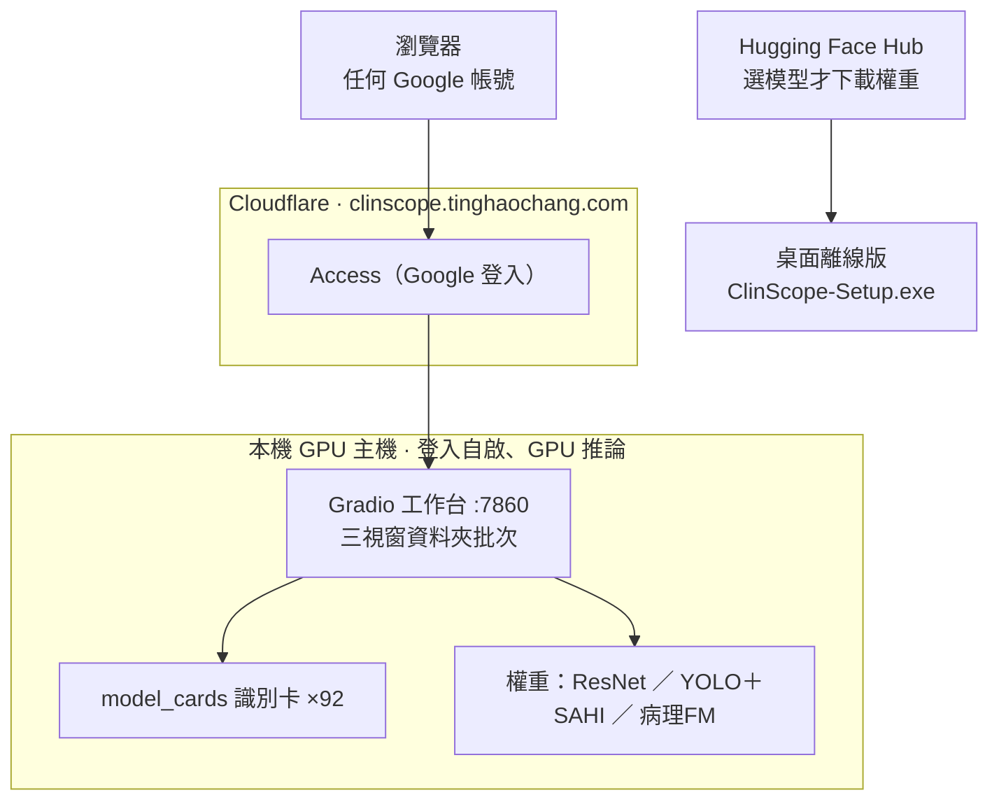

# ClinScope

臨床顯微影像辨識平台 —— 把多種醫檢顯微辨識任務收進**同一個前端**：92 個模型、跨醫檢 ~18 科、十多種成像模態、**ResNet／病理基礎模型(Phikon-v2) 分類 + YOLO(可選 SAHI 切片) 偵測**多引擎。
自學 / 作品集性質，**非臨床診斷工具**。（原名 FungiScope，從純真菌 PoC 擴充而來。）

## 系統架構

雙軌發佈：**線上版**把外網流量經 Cloudflare Access（Google 登入、主要擋自動化機器人）轉進本機 GPU 主機的 Gradio 工作台，由 92 張 `model_cards` 識別卡驅動多引擎模型；**離線版**是桌面安裝檔（`ClinScope-Setup.exe`），選好要用的模型才從 Hugging Face Hub 下載對應權重。真正做 GPU 推論的都是本機那台顯示卡電腦，Cloudflare 只負責把外網轉進來。



- **使用者端**：線上瀏覽器（任何 Google 帳號登入）、桌面離線安裝版。
- **外部服務**：Hugging Face Hub（離線版按需下載權重）、Cloudflare（轉送 + Access 登入關卡）。
- **本機服務**：Gradio 三視窗批次工作台、`model_cards` 識別卡（自動生成整個 UI 與選單）、三引擎權重（ResNet 分類、YOLO＋可選 SAHI 切片偵測、病理基礎模型抽特徵）。

## 現實定位（先讀這段）

這個專案誠實的價值在「**流程與模型能力的展示**」，不是臨床對齊。幾個必須先知道的限制：

- **跨域落差最大**：每個模型只在它自己資料集的分布內準確。換成你自己顯微鏡拍的照片（不同染色法 / 相機 / 倍率），準確率預期掉到 **60–80%**（同 in-distribution vs out-of-distribution 的老坑）。
- **無可下載的臨床「菌種級」模型**：市面上沒有現成可下載的臨床菌種辨識模型，只能自訓；而 LPCB 種級（如皮癬菌 Trichophyton）的公開資料缺口是**結構性的**（鎖在醫院）。
- **成像模態不可混訓**：LPCB 培養 / KOH 直接鏡檢 / Giemsa 血抹片 / Gram 染色 / 免疫螢光（IIF）各自是獨立 track，不能混在一起訓練。
- **小驗證集數字不可信**：DIBaS 每類僅 ~20 張，val=1.0 是採集洩漏 + 噪音造成的假象，需要 group-aware split / k-fold 才有意義。

## 已收錄模型（皆 in-distribution 成績）

| 科別 | Track | 模態 / 染色 | 引擎 | 資料 | 成績 |
|---|---|---|---|---|---|
| 微生物（真菌） | OpenFungi | LPCB 培養 | ResNet-50 | 571 張 / 6 屬 | val 0.98 ⚠️ 小 val |
| 微生物（真菌） | DeFungi | KOH 直接鏡檢 | ResNet-50 | 9,114 張 / 5 類 | val 0.905 |
| 微生物（細菌） | DIBaS | Gram 染色 | ResNet-50 | 689 張 / 33 種 | ⚠️ val=1.0 小樣本不可信 |
| 寄生蟲 | NIH Malaria | Giemsa 血抹片 | ResNet-50 | 27,558 張 / 2 類 | val 0.973 |
| 寄生蟲 | Chula-ParasiteEgg-11 | 糞便濕抹片 | ResNet-50 | 11,000 張 / 11 類 | val 0.995 |
| 血液 | PBC 白血球分類 | Wright/Giemsa | ResNet-50 | 17,093 張 / 8 類 | val 0.992 |
| 血液 | BCCD 血球偵測 | 血抹片 | YOLOv8 | 364 張 | mAP50 0.919 |
| 免疫 | HEp-2 ANA 型態 | 免疫螢光 IIF | ResNet-50 | 13,596 張 / 6 型態 | val 0.980 |
| 細胞學 | SIPaKMeD 子宮頸抹片 | Pap 染色（單細胞） | ResNet-50 | 4,049 細胞 / 5 類 | val 0.970 |
| 男科（精液分析） | SMIDS 精液形態 | 精液抹片（亮場） | ResNet-50 | 3,000 張 / 3 類 | val 0.902 |
| 血液（骨髓細胞學） | Matek 骨髓細胞 | May-Grünwald-Giemsa（骨髓抹片） | ResNet-50 | 154,239 張 / 21 類 | val 0.865 weighted ⚠️ macro-F1 0.71 |
| 組織病理（肺/結腸） | LC25000 | H&E 組織切片 | ResNet-50 | 25,000 張 / 5 類 | val 1.00 ⚠️ 增強擴增、隨機 split 洩漏 |
| 組織病理（乳腺） | BreakHis | H&E 組織切片（40–400×） | ResNet-50 | 7,909 張 / 70 病人 / 2 類 | val 0.839 ✅ 病人級切分、macro-F1 0.829 |
| 組織病理（結直腸） | NCT-CRC-HE-100K | H&E 組織切片（224px） | ResNet-50 | 100,000 張 / 9 類 | val 0.970（官方外部 7K cohort） |
| 組織病理（淋巴結） | PatchCamelyon | H&E 組織切片（96px patch） | ResNet-50 | 262,144 張 / 2 類 | val 0.913（官方 val 32k） |
| 組織病理（大腸息肉） | MHIST | H&E 組織切片 | ResNet-50 | 3,152 張 / 2 類 | val 0.922（HP vs SSA 診斷）|
| 細胞學（甲狀腺 FNA） | CytoAtlas 甲狀腺 | 細胞學抹片（FNA） | ResNet-50 | 27,496 張 / 118 片 / 6 類 | val 0.505 ✅ 片級切分、macro-F1 0.518（⚠️ 舊 0.947 為同片洩漏假象）|
| 組織病理（乳腺 mitosis） | Mitosis 偵測 | H&E 組織切片 | YOLOv8 | 274 張 / 1 類 | mAP50 0.941 |
| 男科（精子頭形態） | HuSHeM | Diff-Quik 精子頭 | ResNet-50 | 216 張 / 4 類 | val 0.94 ⚠️ 極小 val 不可信 |
| 血液（紅血球形態） | RBC morphology | 血液抹片（單顆 RBC） | ResNet-50 | 6,240 張 / 11 類 | val 0.978、macro-F1 0.972 |
| 血液腫瘤（白血病） | C-NMC 2019 | 血液抹片（單細胞） | ResNet-50 | 10,311 張 / 2 類 | val 0.853 ✅ 病人級切分、無洩漏 |
| 寄生蟲（瘧原蟲種級） | MP-IDB | 薄血膜 Giemsa（全視野） | ResNet-50 | 210 圖 / 17 片 / 4 種 | val 0.509 ✅ 片級切分、macro-F1 0.348（⚠️ 稀有種僅 2–3 片、Malariae 失敗）|
| 血液（鐮刀型紅血球） | erythrocytesIDB | 血液抹片（單顆 RBC） | ResNet-50 | 626 張 / 3 類 | val 0.984、macro-F1 0.984 ⚠️ val 偏小 |
| 組織病理（細胞核偵測） | PanNuke | H&E 組織切片 | YOLOv8 | 7,901 圖 / 5 核類 | mAP50 0.654（val 6.7 萬框） |
| 血液（白血球擴充） | UNIVALI | 周邊血抹片 | ResNet-50 | 10,697 張 / 14 類 | val 0.905、macro-F1 0.816 ⚠️ 未成熟稀有類弱 |
| 組織病理（乳腺嚴重度） | BACH ICIAR2018 | H&E 組織切片（tile） | ResNet-50 | 400 圖→4,800 tile / 4 級 | val 0.873（影像級切分、無 tile 洩漏） |
| 組織病理（甲狀腺 PTC） | PathoTiroid PTIC | H&E 組織切片 | ResNet-50 | 1,006 張 / 2 類 | val 0.994 ✅ 病人級切分（⚠️ 僅 5 病人） |
| 尿液分析（尿沉渣） | Urine particles | 明場尿沉渣 | YOLOv8 | 4,250 圖 / 7 類 | mAP50 0.896 |
| 微生物/泌尿（UTI 尿沉渣） | UTI urine (RODARE) | 未染色明場 | YOLOv8 | 300 圖 / 7 類 | mAP50 0.402 ⚠️ 小資料、語意遮罩→併框、與既有尿沉渣 track 重疊 |
| 細胞學（BALF 肺泡灌洗液） | PW-BALFC | Diff-Quik/Gram 明場 | YOLOv8 | 2,105 圖 / 7 類 | mAP50 0.810、mAP50-95 0.592 ✅ 七類皆佳 ⚠️ id→名推定 |
| 組織病理（跨掃描儀分裂） | MIDOG 2021 | H&E ROI（3 台掃描儀） | YOLOv8 | 150 圖→1,982 tile / 2 類 | mAP50 0.362（scanner-disjoint 跨域，mitotic 單類 0.56）⚠️ domain-gen 示範、刻意跨掃描儀掉分 |
| 組織病理（子宮頸 AIS） | CASIHI | H&E 腺體組織切片 | ResNet-50 | 2,242 圖 / 2 類 | val 0.982、macro-F1 0.982 ✅ ⚠️ 單中心、2 類、跨域恐掉 |
| 血液（單細胞 18 類） | MLL23 | Giemsa 單 WBC | ResNet-50 | 41,621 張 / 18 類 | val 0.948、macro-F1 0.861（含毛細胞白血病） |
| 血液（RBC 排列） | Rouleaux | Giemsa 全視野薄血膜 | ResNet-50 | 1,544 張 / 2 類 | val 1.0 ⚠️ 任務易+val 小，恐受試者洩漏 |
| 血液/骨髓（巨核細胞） | MK-11 | Wright-Giemsa 單細胞 | ResNet-50 | 7,204 張 / 11 亞型 | val 0.810 ✅ 病人級切分 |
| 寄生蟲（錐蟲） | Tryp | 未染色厚血膜 | YOLOv8 | 3,166 圖 / 1 類 | mAP50 0.807 |
| 組織病理（胃分化分級） | PatchGastric | H&E WSI patch | ResNet-50 | 37,930 patch / 4 級 | val 0.489 ✅ WSI 級切分（分級本就難） |
| 組織病理（腦膠質瘤） | IPD-Brain | H&E WSI tile | ResNet-50 | 5,901 tile / 3 類 | val 0.529 ⚠️ 病人級但近多數類基線 |
| 寄生蟲（血液原蟲） | Blood protozoa | Giemsa 顯微 | ResNet-50 | 1,049 張 / 3 類 | val 1.0 ⚠️ 形態差異大+val 小 |
| 細胞遺傳學（染色體） | Chromosome | G-band 灰階單條染色體 | ResNet-50 | 2,986 張 / 24 類 | val 0.886 ✅ macro-F1 0.889（⚠️ 隨機 split、無 karyotype 分組） |
| 免疫組化（HER2 評分） | HER2-IHC | IHC/DAB 棕染 patch | ResNet-50 | 9,940 patch / 4 級 | val 0.985 ✅ macro-F1 0.982、官方 patch 級切分 |
| 寄生蟲（腸道原蟲） | ParasitoBank | 糞便濕抹片 saline+Lugol | YOLOv8 | 779 圖 / 13 類 | mAP50 0.752 ✅（⚠️ 稀有蠕蟲類 val 1–2 框不可信） |
| 寄生蟲（瘧分期） | BBBC041 | Giemsa 薄血膜全視野 | YOLOv8 | 1,328 圖 / 5 類 | mAP50 0.395 ✅（瘧蟲期偵測本就難,稀有期不可信） |
| 微生物（革蘭氏痰抹片） | M-ROSE | Gram 染色下呼吸道抹片 | YOLOv8 | 6,005 tile / 2 類(G±) | mAP50 0.908 ✅ source-disjoint 切分 |
| 微生物（培養盤菌落） | Dataset19 | 白光巨觀 agar plate | YOLOv8 | 950 圖 / 19 菌種 | mAP50 0.970 ✅ mAP50-95 0.764 |
| 寄生蟲（皮膚利什曼） | Leishmania | Giemsa 皮膚抹片 | YOLOv8 | ~1,300 圖 / 1 類 | mAP50 0.651 ✅ slide-disjoint 切分 |
| 寄生蟲（水源性囊體） | Giardia/Crypto | 明場顯微 | YOLOv8 | 1,837 圖 / 2 類 | mAP50 0.895 ✅（環境樣本,非臨床糞便） |
| 血液（白血球+血小板） | KU-optofil 13 類 | May-Grünwald-Giemsa（Sysmex DI-60 數位） | ResNet-50 | 25,178 張 / 13 類 | val 0.961、macro-F1 0.845 ✅ patient-level split（⚠️ Myelocyte val 9 張學不起來、稀有類弱） |
| 血液（骨髓 MDS） | MDS 骨髓 29 類 | May-Grünwald-Giemsa（骨髓抹片） | ResNet-50 | 25,001 張 / 29 類 | val 0.773、macro-F1 0.590 ⚠️ 隨機 split、稀有發育不良類弱 |
| 組織病理（攝護腺 Gleason） | SICAPv2 | H&E patch | ResNet-50 | 9,959 patch / 4 類 | val 0.721、macro-F1 0.630 ✅ slide-disjoint 切分（G5 弱） |
| 血液（裂紅細胞偵測） | SBSD | Giemsa 血抹片 | YOLOv8 | 615 圖 / 6 類 | mAP50 0.895、mAP50-95 0.713 |
| 男科（精子偵測） | EVISAN | 顯微（200X/600X） | YOLOv8 | 6,000 圖 / 2 類 | mAP50 0.436 ✅ video-disjoint 切分 |
| 微生物（血培養革蘭氏） | Blood-culture Gram | Gram 染色 ×100 油鏡 | YOLOv8 | 505 圖 / 1 類 | mAP50 0.737、mAP50-95 0.420 |
| 組織病理（黑色素瘤核） | PUMA | H&E ROI 1024px | YOLOv8 **+SAHI** | 206 ROI / 10 核類 | mAP50 0.193→**0.276**（SAHI 切片 +37.6%）⚠️ 類別極不平衡 |
| 微生物（結核 ZN 偵測） | TB-ZN bacilli | ZN 痰抹片（手機顯微） | YOLOv8 | 1,265 圖 / 1 類 | mAP50 0.840、mAP50-95 0.414 🎯 填結核缺口 |
| 微生物（結核 ZN 分類） | TB-ZN 陽/陰 | ZN 痰抹片 | ResNet-50 | 1,000 圖 / 2 類 | val 0.99、macro-F1 0.972 ⚠️ Pos val 20、疑片級洩漏 |
| 組織病理（多器官核） | NuInsSeg | H&E 31 器官 | YOLOv8 | 665 圖 / 1 類 | mAP50 0.618、mAP50-95 0.334 |
| 細胞學（體腔積液） | 積液 良/惡 | 積液離心抹片 | ResNet-50 | 693 圖 / 2 類 | val 1.0 ⚠️ 影像級切分疑洩漏、僅 demo |
| 分子病理（大腸癌 MSI） | CRC MSI/MSS | H&E patch | ResNet-50 | ~99k val / 2 類 | val 0.753、macro-F1 0.629 ⚠️ MSImut recall 0.31、patch 級切分 |
| 組織病理（口腔鱗癌） | ORCHID OSCC | H&E | ResNet-50 | 4,477 圖 / 5 類 | val 0.881、macro-F1 0.894 ✅ 含 OSMF 癌前 |
| 組織病理（腎絲球） | 腎絲球 正常/硬化 | H&E/PAS | YOLOv8 | 78 圖 / 2 類 | mAP50 0.465 ⚠️ 極小資料、recall 0.40 |
| 免疫組化（肺多重 IHC） | MIHIC | multiplex-IHC | ResNet-50 | 7 組織類 | val 0.838、macro-F1 0.836（每類抽樣）|
| 寄生蟲（陰道滴蟲） | TVMI3K | 濕抹片 | YOLOv8 | 3,158 圖 / 1 類 | mAP50 0.417、mAP50-95 0.240 |
| 黴菌（皮癬菌絲 KOH） | KOH hyphae | 皮屑/指甲 KOH | YOLOv8 | 2,721 圖 / 1 類 | mAP50 0.865、mAP50-95 0.513 🎯 填 KOH 缺口 |
| 免疫腫瘤（TIL） | TCGA-TILs | 多癌種 H&E | ResNet-50 | 4k val / 2 類 | val 0.896、macro-F1 0.896 ✅ patient-disjoint |
| 組織病理（胎盤） | HAPPY 絨毛細胞 | H&E | ResNet-50 | 6,951 圖 / 9 類 | val 0.886、macro-F1 0.839 |
| 寄生蟲（瘧疾厚/薄抹片） | Tanzania malaria | Giemsa 血膜 | ResNet-50 | 3,544 圖 / 4 類 | val 0.998 ⚠️ 影像級切分疑洩漏 |
| 細胞學（子宮頸 Bethesda） | RIVA | 子宮頸抹片 | YOLOv8 | 959 圖 / 8 類 | mAP50 0.146 ⚠️ 點標註合成框、類別不平衡 |
| 細胞學（腦脊髓液 CSF） | CSF 16 類 | 體液離心抹片 | ResNet-50 | ~30k 圖 / 16 類 | val 0.829、macro-F1 0.686 ✅ patient-disjoint |
| 眼科（角膜共軛焦） | IVCM 角膜炎 | 共軛焦顯微 | ResNet-50 | ~3k 圖 / 4 類 | val 0.981、macro-F1 0.965 ⚠️ 影像級切分疑洩漏 |
| 組織病理（凍結切片核） | CryoNuSeg | 冷凍切片 H&E | YOLOv8 | 30 圖 / 1 類 | mAP50 0.466、mAP50-95 0.265 ⚠️ val 僅 10 張 |
| 生殖（IVF 囊胚分級） | Blastocyst | 胚胎明場 | ResNet-50 | 2,342 圖 / 5 類 | val 0.775、macro-F1 0.686 ✅ embryo-disjoint |
| 血液（RBC 9 類·貧血篩檢） | Thalassemia RBC | 血液抹片（單顆 RBC） | ResNet-50 | 7,108 圖 / 9 類 | val 0.952、macro-F1 0.871 ⚠️ 隨機 split、pencil 4 張 |
| 組織病理（骨肉瘤存活度） | Osteosarcoma | H&E tile | ResNet-50 | 2,387 圖 / 3 類 | val 0.991、macro-F1 0.991 ✅ 官方 split |
| 組織病理（乳腺 IDC 分級） | Breast IDC grade | H&E 40× | ResNet-50 | 454 圖 / 3 類 | val 0.691、macro-F1 0.695 ⚠️ 小資料、隨機 split |
| 男科（精子 DNA 碎片化） | Sperm SCD halo | SCD 染色質擴散 | ResNet-50 | 403 圖 / 4 類 | val 0.983、macro-F1 0.983 |
| 組織病理（大腸分化 6 階段） | EBHI-SEG | H&E 組織 | ResNet-50 | 2,228 圖 / 6 類 | val 0.949、macro-F1 0.923 |
| 細胞遺傳學（核型偵測） | AutoKary2022 | 中期分裂全圖 | YOLOv8 | 1,257 圖 / 24 類 | mAP50 0.851、mAP50-95 0.663 |
| 寄生蟲（克氏錐蟲 Chagas） | T. cruzi | Giemsa 血抹片 | YOLOv8 | 726 圖 / 1 類 | mAP50 0.257 ⚠️ val 蟲體稀疏、case-disjoint |
| 組織病理（卵巢癌 5 亞型） | UBC-OCEAN | H&E 縮圖 | **Phikon-v2 FM**+LogReg | 538 圖 / 5 類 | val 0.543→**0.679**、macro-F1 0.436→**0.604**（病理 FM 取代 ResNet，救回 LGSC）|
| 組織病理（乳腺 7 類細分） | BRACS | H&E 299px | ResNet-50 | 4,391 圖 / 7 類 | val 0.659、macro-F1 0.641 ⚠️ 細粒度、相鄰類易混 |
| 血液腫瘤（漿細胞偵測） | SegPC-2021 | 骨髓抹片 | YOLOv8 | 498 圖 / 1 類 | mAP50 0.833、mAP50-95 0.735 ✅ 官方 split |
| 組織病理（胃癌 TME 8 類） | HMU-GC | H&E patch | ResNet-50 | 31,096 圖 / 8 類 | val 0.746、macro-F1 0.747 ⚠️ patch 隨機 split |
| 組織病理（腎絲球分類） | Glomeruli char | PAS patch | ResNet-50 | 2,340 圖 / 2 類 | val 0.997 ⚠️ 隨機 split 含洩漏 |
| 獸醫（家畜糞檢蟲卵） | Vet egg | 光學顯微 | ResNet-50 | 546 圖 / 6 類 | val 0.893、macro-F1 0.785 ⚠️ 小資料 |
| 微生物（絲狀黴菌 6 屬） | OpenFungi | 乳酸酚棉藍鏡檢 | ResNet-50 | 571 圖 / 6 類 | val 0.989、macro-F1 0.958 ⚠️ val 極小、不平衡 |
| 細胞學（多染色核偵測 22 類） | UFSC-MultiCyto | Pap/AgNOR/Feulgen | YOLOv8 | 14,950 圖 / 22 類 | mAP50 0.497、mAP50-95 0.375 ⚠️ 長尾 |
| 寄生蟲（血/體液 8 類面板） | Parasites panel | Giemsa | ResNet-50 | 34,298 圖 / 8 類 | val 0.998 ⚠️ 強烈疑單源洩漏 |
| 細胞學（口腔脫落核偵測） | Oral cytology | Pap 抹片 | YOLOv8 | 739 圖 / 4 類 | mAP50 0.486、mAP50-95 0.356 ⚠️ 密集小核 |
| 獸醫（腸道寄生蟲偵測） | 犬貓 GI 寄生蟲 | TF-Test VetPet 明場 | YOLOv8s | 3,339 圖 / 9 類 | mAP50 0.869、mAP50-95 0.763 ⚠️ 種名未公開用代碼、稀有類弱 |
| 法醫／環境（淡水矽藻） | UDE Diatoms | focus-stacked 光學 | ResNet-50 | 67,594 圖 / 101 種 | val 0.728、macro-F1 0.520 ⚠️ 長尾、片級切分無洩漏 |
| 法醫／環境（花粉孢粉） | POLLEN73S | 光學顯微 | ResNet-50 | 2,523 圖 / 73 種 | val 0.950、macro-F1 0.949 ⚠️ 小資料、隨機 split |

> 分類模型回傳 top-k 機率；偵測模型回傳標註圖 + 每類計數。`app.py` 只會列出**權重檔存在**的模型，所以即使某些 track 還沒訓練好，前端也能正常啟動。

## 架構

```
分類 track：prepare_data.py → train_resnet.py → predict.py
偵測 track：prepare_yolo.py → train_yolo.py → predict_yolo.py
統一前端  ：app.py（Gradio, 127.0.0.1:7860）
```

pipeline 已通用化，新增一條 track 不必改核心程式 —— 只要備好資料、訓練、在 `app.py` 的 `REGISTRY` 加一條。完整流程與踩過的坑見 `.claude/skills/add-dataset-track/`。

## 環境

- Python 3.11 venv（`.venv/`），不用 conda
- GPU：RTX 4060 Ti 8GB，PyTorch **CUDA 12.4** wheel
- 主要套件：torch / torchvision、ultralytics（YOLO）、scikit-learn、gradio、matplotlib、pillow、tqdm

```powershell
# torch/torchvision 先從 cu124 index 裝，其餘走 requirements.txt
pip install torch torchvision --index-url https://download.pytorch.org/whl/cu124
pip install -r requirements.txt
```

執行一律用 `.\.venv\Scripts\python.exe`，並傳**絕對路徑**（本機 CWD 是 `D:\Claude code` 不是專案根）。

## 執行

```powershell
# 啟動統一前端（上傳圖 → 選模型 → 辨識）
.\.venv\Scripts\python.exe app.py
# 然後開 http://127.0.0.1:7860

# 訓練一條分類 track（範例）
.\.venv\Scripts\python.exe -u src\train_resnet.py --data-dir data\<name>_split --epochs 15 --title "<標題>"

# 對單張或整夾推論
.\.venv\Scripts\python.exe src\predict.py --model models\<name>_resnet50.pt --input <圖或資料夾> --topk 3
```

## 目錄

- `app.py` — Gradio 統一前端，含 11 條 track 的 model registry
- `src/prepare_data.py` — 解壓 / 切分 ImageFolder（內建自動驗圖剔除壞檔）
- `src/train_resnet.py` — ResNet-50 transfer learning（two-phase 凍結→微調、class-weighted loss、AMP）
- `src/predict.py` — 分類推論 / 跨域實測
- `src/prepare_yolo.py` — Pascal VOC → YOLO 格式轉換
- `src/train_yolo.py` — YOLOv8 偵測訓練（ultralytics，內建早停）
- `src/predict_yolo.py` — YOLO 推論：標註圖 + 每類計數
- `data/`、`models/`、`reports/`、`.venv/` — 已 gitignore，不進版控

## 資料來源

| Track | 來源 |
|---|---|
| OpenFungi | MDPI *Life* 2025（DOI 10.3390/life15071132），Zenodo 10.5281/zenodo.15692069 |
| DeFungi | UCI Machine Learning Repository（id 773） |
| NIH Malaria | NIH / NLM Cell Images for Malaria Detection |
| Chula-ParasiteEgg-11 | Hugging Face `Abdelkareem/parasitic-egg`（parquet 內嵌圖，11 類腸道蟲卵） |
| PBC（白血球） | Mendeley Data `snkd93bnjr` |
| DIBaS | 33 菌種 Gram 染色，學術鏡像 doctoral.matinf.uj.edu.pl |
| HEp-2 | Hugging Face `Genius-Society/HEp2` |
| BCCD | Blood Cell Count and Detection（Pascal VOC） |
| SIPaKMeD | Univ. of Ioannina `cs.uoi.gr/~marina/SIPAKMED`（5× `.7z`，單細胞 CROPPED 子集） |
| SMIDS | Mendeley Data `6xvdhc9fyb`（精液形態 3 類:正常/異常/非精子,3,000 張亮場 BMP） |
| Matek 骨髓 | Hugging Face `ekim15/bone_marrow_cell_dataset`（parquet 內嵌圖,21 類骨髓細胞,官方病人層級 train/val/test 切分） |
| LC25000 | Hugging Face `1aurent/LC25000`（parquet,organ×label 還原肺/結腸 5 類 H&E） |
| BreakHis | Mendeley Data `jxwvdwhpc2`（乳腺腫瘤 H&E,40–400× 放大倍率混訓的二元良/惡） |
| NCT-CRC-HE-100K | Zenodo 10.5281/zenodo.1214456（train 100K + 官方獨立 cohort CRC-VAL-HE-7K 當 val） |
| PatchCamelyon | Hugging Face `1aurent/PatchCamelyon`（parquet,官方 train/val split,淋巴結轉移 binary） |
| MHIST | Hugging Face `mamunrobi35/mhist_binary`（大腸息肉 HP vs SSA;mirror 為 flatten bytes/path schema） |
| 甲狀腺細胞學 | Hugging Face `cupofmocha/cytoal-thyroid-cytology-labeled`（imagefolder,6 類 FNA,cc-by-nc-4.0） |
| Mitosis 偵測 | Hugging Face `Francesco/mitosis-gjs3g`（Roboflow RF100 COCO,COCO→YOLO 轉換） |
| HuSHeM | Mendeley Data `tt3yj2pf38`（精子頭形態 4 類 `.rar`,Diff-Quik 染色） |
| RBC morphology | Zenodo `10.5281/zenodo.14936017`（紅血球異形 poikilocytosis 11 類 `.rar`,CC-BY-4.0;血液抹片單顆紅血球） |
| C-NMC leukemia | Hugging Face `dwb2023/cnmc-leukemia-2019`（B-ALL blast vs 正常,parquet 含 subject_id/fold,MIT;以 subject_id 做病人級切分避洩漏） |
| MP-IDB malaria | GitHub `andrealoddo/MP-IDB-The-Malaria-Parasite-Image-Database-for-Image-Processing-and-Analysis`（瘧原蟲 4 種,全視野 img + mask + 部分 crops;codeload zip。片級切分用全視野 img、檔名前綴=血片 id） |
| erythrocytesIDB | Zenodo `10.5281/zenodo.18299473`（鐮刀型紅血球 3 類,UIB;用 erythrocytesIDB1 individual cells 標註子集） |
| PanNuke | Hugging Face `RationAI/PanNuke`（H&E 核 instance mask;自寫 `src/pannuke_to_yolo.py` 轉 mask→YOLO bbox） |
| UNIVALI leukocyte | Zenodo `10.5281/zenodo.17743609`（白血球 14 類 ViT class-folder export,Roboflow one-hot CSV→ImageFolder,UNIVALI 巴西） |
| BACH | Hugging Face `1aurent/BACH`（ICIAR2018 乳腺 4 級大圖;自寫 `src/bach_tile_group_split.py` 切 512 tile + 影像級切分） |
| PathoTiroid | Zenodo `10.5281/zenodo.18827019`（甲狀腺 PTC vs 非PTC,24 病人 PTIC;以檔名 patient token 做病人級切分） |
| Urine sediment | Hugging Face `dikaizm/urine-particle-image-dataset`（尿沉渣 7 類 Roboflow COCO,官方 split;`coco_to_yolo` 轉 YOLO） |
| UTI urine | RODARE `10.14278/rodare.2473`（UTI 未染色尿沉渣 7 類語意遮罩,官方 train/val/test;`prep_uti.py` mult_mask 連通元件→bbox;RODARE 端點 B `/record/.../files/` 才支援 range 續傳） |
| BALF cell | Zenodo `14871206`（PW-BALFC 支氣管肺泡灌洗液 7 類,官方 train/val;只取 Images.rar+Labels.rar 標準解析跳過 24GB 高解析;`prep_balf.py` polygon→bbox） |
| MIDOG 2021 | Zenodo `4643381`（跨掃描儀有絲分裂 150 標註 TIFF+COCO json;`prep_midog.py` tile 1280px + scanner-disjoint split:掃描儀1-2 train/掃描儀3 val） |
| Cervical AIS | figshare `24548953`（CASIHI 子宮頸腺癌原位 vs 正常腺體 2 類;⚠️ figshare 簽章 URL 10 秒過期→aria2c 必用單連線 `-x1 -s1`） |
| MLL23 | Zenodo `14277609`（周邊血 18 類 per-class zip,含毛細胞白血病/芽細胞/抹片細胞;MLL 慕尼黑） |
| Rouleaux | Zenodo `13763939`（串錢狀 vs 正常 RBC 薄血膜,100 受試者;用 original-form 全視野） |
| MK-11 | figshare `29264819`（骨髓巨核細胞 11 亞型,class 子資料夾 + 官方 5-fold 病人級切分） |
| Tryp | figshare `32397798`（錐蟲未染色厚血膜偵測,YOLO 標註 v3 + 陰性背景;Sci Data 2023） |
| PatchGastric | Zenodo `6550925`（胃腺癌 ADC22 WSI patch + captions.csv subtype;自寫 `src/patchgastric_wsi_split.py` WSI 級切分、9 亞型併 4 分化分級） |
| IPD-Brain | figshare `27186087`（腦膠質瘤 3 亞型大圖 + IPD_Brain.csv;自寫 `src/ipdbrain_tile_split.py` tile + 病人級切分） |
| Blood protozoa | Hugging Face `eliplutchok/microscopy-parasites`（Babesia/Toxoplasma/Trypanosoma 3 類 ClassLabel parquet） |
| Chromosome | GitHub `CloudDataLab/CIR-Net`（G-band 單條染色體 24 類 `origin.tar.gz`,類別編在檔名;隨機 split，無 karyotype 分組可還原） |
| HER2-IHC | Zenodo `15179608`（HER2 乳腺 IHC 40× patch 0/1+/2+/3+;官方 train/test split-before-patch,低洩漏） |
| ParasitoBank | Mendeley `725hpzpwzf`（糞便腸道寄生蟲 13 類單一 COCO,779 圖;自寫腳本 image-level split + COCO→YOLO） |
| BBBC041 | Broad BBBC041（P. vivax 瘧分期,自訂 r/c JSON;官方 split,保留 4 蟲期+WBC、剔 RBC 背景轉 YOLO） |
| M-ROSE | Zenodo `10526360`（CPLAG 革蘭氏痰抹片 DeepDataSet;用 640 json 染色標註做 2 類 G+/G- 偵測,source-disjoint 切分） |
| Dataset19 | Zenodo `18256864`（19 菌種瓊脂培養盤菌落偵測,現成 YOLO_txt + images/<種>;stratified-by-species split,類名沿用原始代碼） |
| Leishmania | Zenodo `17964511`（皮膚利什曼原蟲偵測,YOLO bbox + 官方 slide-disjoint split;合併 Dataset_1+2,test 併入 val） |
| Giardia/Crypto | Zenodo `7813183`（Giardia 囊體 + Cryptosporidium 卵囊偵測 COCO;合併 brightfield reference+sample,官方 fold_1 split。⚠️ 用直連檔 `cysts_dataset_all.zip` 非 files-archive） |
| KU-optofil 13 類 | Zenodo `17333317`（Sysmex DI-60 周邊血 13 類單顆細胞,官方 patient-level split CSV;含巨大血小板/血小板聚集 2 類為既有 WBC track 所無） |
| MDS 骨髓 29 類 | Figshare `28737170`（MDS 骨髓細胞學,合併 main+add 子集;ndownloader 直連,丟 <10 張類後 32→29 類,隨機 split） |
| SICAPv2 | Zenodo `14178894`（攝護腺 Gleason,NormalizedSICAPv2 子集 + Train/Val.xlsx 官方 slide-disjoint split;argmax one-hot→NC/G3/G4/G5） |
| SBSD | Zenodo `15676241`（血抹片 6 類含裂紅細胞 Schistocyte,現成 YOLO txt + classes.txt;影像級切分） |
| EVISAN | Zenodo `4303768`（多精子偵測 VOC xml,自寫 xml→YOLO;video-block-disjoint split 避免相鄰幀洩漏） |
| Blood-culture Gram | Figshare `26004610`（陽性血培養 Gram 抹片,COCO DoubleCheck 共識標註;影像級切分,1 類 microorganism） |
| PUMA | Zenodo `13859989`（原發+轉移黑色素瘤 H&E,GeoJSON 10 核類 polygon→bbox;ROI 級切分,CC0） |
| TB-ZN bacilli | Kaggle `saife245/tuberculosis-image-datasets`（Makerere phonecamera ZN 痰抹片,VOC `<label>`TBbacillus→YOLO;kaggle CLI 自動抓） |
| TB-ZN 陽/陰 | Mendeley `yhybmfrmgs`（ZN 痰抹片陽/陰性,培養確診;ImageFolder Negative/Positive,影像級切分） |
| NuInsSeg | Zenodo `10518968`（31 器官 H&E 核 instance seg;label mask 連通標記→bbox,器官分層切分,1 類 nucleus） |
| 積液細胞學 | Kaggle `cmacus/body-cavity-fluid-cytology-images`（體腔積液良/惡細胞團;影像級切分。© 原作者,研究用） |
| CRC MSI/MSS | Kather CRC-MSI（TCGA H&E patch 預測微衛星不穩定 MSImut/MSS;patch 級切分,⚠️ 同病人可能跨 train/val） |
| ORCHID OSCC | Zenodo `12646943`（口腔鱗癌 H&E 5 類含 OSMF;官方 val→train、test→val,case 不跨） |
| 腎絲球 | Zenodo `4299694`（腎切片腎絲球 normal/sclerosed;mask 顏色→bbox,slide-disjoint,78 圖） |
| MIHIC | Zenodo `10065510`（肺癌多重 IHC 組織 7 類;原始 19.5 萬張,每類抽樣訓練） |
| TVMI3K | Zenodo `6534086`（陰道滴蟲濕抹片偵測;官方 Train/Test,mask 連通標記→bbox） |
| KOH hyphae | Figshare `14678514`（皮屑/指甲 KOH 菌絲;40×+100× YOLO 格式,含背景負樣本,1 類 hyphae） |
| TCGA-TILs | Zenodo `6604094`（多癌種 H&E TIL ±;依 TCGA barcode patient-disjoint 抽樣、去重 hardlink） |
| HAPPY 胎盤 | Zenodo `10535022`（胎盤絨毛細胞 9 類;官方 cell_class CSV split,跨 3 機構 pool） |
| Tanzania malaria | Harvard Dataverse（瘧疾厚/薄抹片 × 感染/未感染 4 類;⚠️ 影像級切分） |
| RIVA | Zenodo `17288879`（子宮頸 Bethesda 8 類;關鍵點→固定框近似,case-disjoint） |
| CSF 16 類 | Zenodo `6543147`（腦脊髓液細胞學 16 類;檔名 Liquor_<病人> patient-disjoint,大類抽樣） |
| IVCM 角膜炎 | Figshare `19838083`（角膜活體共軛焦 4 類:棘阿米巴/真菌/非特異/健康;影像級切分） |
| CryoNuSeg | Kaggle `ipateam/segmentation-of-nuclei-in-cryosectioned-he-images`（冷凍切片 H&E 10 器官核 instance→bbox;組織級切分,val 僅 10 張） |
| Blastocyst | Figshare `20123153`（人類囊胚 IVF benchmark;Gardner 擴張度 5 類;官方 train(silver)/test(gold) embryo-disjoint） |
| Thalassemia RBC | Mendeley `rfdz6wfzn4`（RBCdataset 9 類紅血球形態;地中海貧血/貧血篩檢;隨機 split） |
| Osteosarcoma | Kaggle `tatsuyaryu/osteosarcoma-histopathology-classification`（TCIA UT Southwestern;非腫瘤/壞死/存活 3 類;官方 split） |
| Breast IDC grade | Mendeley `w7jjcx7gj6`（浸潤性乳管癌 Nottingham 分級 1/2/3;40× tile;隨機 split） |
| Sperm SCD halo | Figshare `30120811`（精子染色質擴散 SCD;halo 大小 4 類=DNA 碎片化程度） |
| EBHI-SEG | Figshare `21540159`（大腸 H&E 6 分化階段;正常→息肉→低/高度 IN→腺癌→鋸齒狀;取代 UniToPatho） |
| AutoKary2022 | Roboflow `karyotypezhongxin/autokary2022`（中期分裂染色體全圖 24 類偵測;polygon→bbox;ICME2023） |
| T. cruzi | Zenodo `15007339`（克氏錐蟲 Chagas Giemsa 血抹片 det;case-disjoint;CC-BY-NC） |
| UBC-OCEAN | Kaggle 競賽 `UBC-OCEAN` 標籤 + 縮圖鏡像 `utm529fg/ubc-reduced-png-2964x2964`（卵巢癌 5 亞型;降採 2964px） |
| BRACS | Kaggle `assismathias/bracs-original-299`（乳腺 7 類 N/PB/UDH/FEA/ADH/DCIS/IC;官方 train/val/test;299px） |
| SegPC-2021 | Kaggle `sbilab/segpc2021dataset`（多發性骨髓瘤漿細胞 instance→bbox det;官方 train/val） |
| HMU-GC | Figshare `25954813`（HMU-GC-HE-30K;胃癌 TME 8 類 patch;patch 級隨機 split） |
| Glomeruli char | Mendeley `k7nvtgn2x6`（腎絲球 normal/sclerosed patch cls;DATASET_B;隨機 split 含洩漏） |
| Vet egg | Mendeley `wbvb4whbks`（獸醫家畜糞檢蟲卵 6 類;Ascaris/Fasciola/Balantidium…+陰性） |
| UFSC Multi-Cyto | Mendeley `b8bygdxr7r`（子宮頸/口腔 Pap/AgNOR/Feulgen 多染色核偵測 22 類;polygon→bbox;CC-BY-4.0） |
| Parasites panel | Mendeley `38jtn4nzs6`（血/體液寄生蟲 8 類;Babesia/Toxoplasma 新類;合併放大倍率;隨機 split 疑洩漏） |
| Oral cytology | Kaggle `abhijeetptl5/oral-cytology-dataset`（口腔脫落細胞學 Pap 核偵測 4 級;geojson→bbox;2048px 密集核） |

## 免責

研究 / 作品集用途，**非臨床診斷**。所有成績皆為資料集分布內（in-distribution）數字，不代表臨床或真實採檢條件下的表現。
